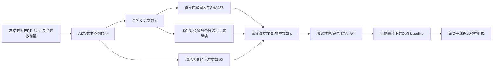

# 跨层价值与当前证据边界

用户关注的七阶段组合搜索有明确研究价值。这里将“阶段数多”与“跨阶段因果链已验证”区分，中心对象是候选及其真实产物如何进入下一阶段。

这张图描述本次实际两阶段实现。下游PPA没有反向变成上游GP的训练标签；本地上游仍用综合QoR。多父传播能保留早期评价不准的候选，**是否真的发生排名反转**另从原始记录检验，不能只因图上连线便宣称跨层收益。

`results/cross_stage_audit.json`与`cross_stage_summary.md`报告每个综合候选的早期QoR、下游已观察最佳QoR、子配置覆盖数、真实slack范围、严格排名反转和剪枝记录。只比较已执行配置；未运行配置无oracle数值。不同父的子配置覆盖不齐，因此“观测最佳”不等于全空间最优。若早剪枝候选后来有独立审计/随机运行观测，报告它能否胜过剪枝当时的baseline，且注明覆盖不足。

## 当前究竟证实了什么

- 阶段接口：RTL/spec→综合参数→真实门级网表→放置参数→合法化布局/寄生/PPA，完整产物连续性有SHA证据，不是把几个独立黑盒目标拼成伪流程。
- 上游改变下游的电路对象：单元、连接、面积与floorplan面积估计随综合候选变化，导致后续布局、功耗及slack改变。下游类别参数空间仍共享同一12项；本次没有证明某个上游选择使某个参数从合法变非法。
- 候选传播与反馈：单父与多父、首次子评估、动态baseline、实际机会数都可复算。默认5%阈值在本批数据未触发剪枝，不能称它带来收益。额外单种子prune_probe缩窄阈值，只用于真实EDA分支覆盖，属于后验机制诊断，绝不混进性能结论。
- 预算：真实综合/放置次数分开；产物复用与唯一配置分开；历史准备54次单独计入。在大历史库上少做在线EDA不自动等价于总成本更低。

## 七阶段中尚未测试的交互

原文七阶段是综合、placement、placement optimization、CTS、CTS optimization、routing、routing optimization。当前只对应前端综合和一个放置阶段，不能将合法化、STA、寄生估计拆名冒充另外几个可调阶段。

尚未测：综合拓扑对时钟树负载/缓冲的影响，CTS对拥塞及信号时序的改变，路线层/拥塞/寄生对早期排名的反转，布线后优化对面积/功耗的反馈，工具失败/合法域收缩，跨多个阶段分支数爆炸与非局部联合最优。本文的两阶段零收益不能否定这些交互；同样，也不能证明它们会产生论文收益。

## 有界、可行的下一步（未执行）

先对一个已验证RTL、固定(s,p)接通OpenROAD global routing，核对DB/netlist/约束连续性及真实报告完整性；这不是详细布线或signoff。只有单链成功才考虑2个综合父×每父2种放置×每个放置2种routing设置：2次综合+4次放置+8次routing=14次阶段评估，产物复用费用明确。用同14次总机会与CPU秒的单父/多父/无剪枝比较，而非将7个阶段各20轮直接放大成昂贵sweep。

路由增量与任何新增历史数据准备都必须单独计时；提前注册rank reversal、错误剪枝率、终态QoR及失败率。原七阶段完整结论仍须更大RTL、更多阶段和可访问的真实模型支持，不能从这条下一步路线提前授予Replicated。

## 本批实际观察

四个目标均有6个综合父候选的放置后代，**严格QoR排名反转为0**。这批小/中等RTL并未给出需要多父保留才能捕捉的排名反转证据。默认5%阈值的剪枝事件为0。

单种子窄阈值探针（ratio=1.00001，后验分支覆盖，不参与性能结论）实际剪掉divider的s=1、s=2：首子QoR均104.506767531，高于当时baseline104.468927577。独立其他运行后来测到这两父的子配置QoR分别104.447881300和104.447526917，均优于当时baseline。它说明“用首个p0判整个父线程”可能错杀有潜力的父，但其余父也能补回相近终态质量；不能据此宣称最终最优值损失。覆盖数和来源以最终JSON为准，未观察部分不补oracle。
