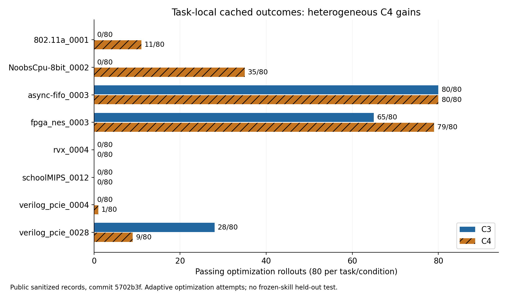

# Paper03 — Trace2Skill 行为复现与审评

日期：2026-10-27。目标：Zijian Du / Nathaniel Pinckney（NVIDIA），**Trace2Skill: Verifier-Guided Skill Evolution for Long-Context EDA Agents**，MLCAD 2026，DOI [10.1145/3831599.3840319](https://doi.org/10.1145/3831599.3840319)。论文版本为 [arXiv:2605.21810v1](https://arxiv.org/html/2605.21810v1)。不是其他同名工作。

**结论：冻结公开记录的数值可复算；若把贡献表述为“任务内、受 verifier 约束的 skill 搜索工程闭环”，证据合理；若表述为“skill 演化优于普通总结/压缩或同预算搜索的新学习机制”，现有证据不足。** 未产生新的在线 LLM 或 RTL 执行结果。

## 来源与边界

统一仓库 `Bol-C14/PaperReproduction`，分支 `reproduction/trace2skill-mlcad2026`。环境中原仓库为无提交初始化目录，`git ls-remote origin` 与显式 `refs/heads/*` 均成功但返回空；按指定分支建立本地初始提交，不修改其他分支、不 push。上游保存在 `upstream/Trace2Skill-…-5702b3fe…/`，保留原代码和许可证，未安装或修改。

[Zenodo 21513682](https://zenodo.org/records/21513682) 页面确认 v1.0.0 与 commit `5702b3fe739ce33013296759162ad771ee11bd36`；直接下载归档 HTTP 403，停止该动作。替代来源是官方 GitHub 对该 commit 的 codeload 归档。`git ls-remote` 独立核验 annotated tag 对象 `9f9629ed7861692e14b8001b72d95474c0d6f507` 对应 tag v1.0.0，peeled commit 为上述 `5702b3…`。**未核验 Zenodo 文件 SHA-256，不能声称两个归档逐字节相同。** SHA-256 见 `metrics/source_hashes.json`、`metrics/acquisition.json`。

完整论文 HTML（正文、参考文献、Appendix A1–A6）已阅读；PDF 直接下载 HTTP 403，未存论文副本。已读上游 README、AGENTS、REPRODUCING、RESULTS、PROVENANCE、SECURITY、Apache-2.0 LICENSE、NeMo Gym LICENSE 与 CVDP 数据许可/NOTICE。CVDP 混合许可且部分组件需额外判断，本包不含数据集或 benchmark Git bundles。代码来自官方发布树，不运行 setup/install 脚本。

## 独立复算

`analysis/recompute.py` 不导入官方 validator，也不读取 expected_results。它检查完整笛卡尔坐标、reward/outcome 一致性、四次重复与 quality 表连接、候选分数与反馈预算，并重新计数。

| 条件 | 成功 / 已保留完成 rollout | 成功率 | 至少一次成功的任务 | runtime verifier 执行 |
|---|---:|---:|---:|---:|
| C3 | 173 / 640 | 27.03125% | 3 / 8 | 0 |
| C4 | 215 / 640 | 33.59375% | 6 / 8 | 1,052 |

每条件 8 tasks × 5 generations × 4 candidates × 4 repeats = 640，未发现重复/缺失坐标。每任务 80 条，含所有候选（包括不能生存的候选），不是只数 survivor 或成功记录。成功定义为最终 hidden-verifier reward=1；runtime feedback 的 pass 不计最终成功。C3 467、C4 425 条失败；细分 exploration/compile/simulation 等见机器记录。

C4 1,130 次反馈请求 = 1,052 执行 + 66 超预算拒绝 + 12 edit/compile gate 拒绝；每 rollout 最多三次**执行**。retry 替换的无效 response 并不额外计入 640；公开记录不够重建全部原始尝试及 transport 次数。



总差 +42/640 = +6.5625 个百分点。逐任务变化为 +11、+35、0、+14、0、0、+1、−19 次（机器表按 task 字母序）。PCIe_0028 退化，NoobsCPU 是最大正贡献。task-paired bootstrap（20,000 次、固定分析 RNG seed=260527）描述区间为 **−5.47 至 +19.84 个百分点**；八个任务是筛选集，一条搜索 lineage/任务/条件，区间不是在线因果置信保证。

仅供识别伪精度：把 640 行误当 iid 时 Wilson 95% 区间为 C3 23.73–30.60%、C4 30.04–37.34%；共享 skill、同任务与自适应选优破坏独立假设，不用该区间宣称显著。`repeat_index` 是保存顺序，不是随机 seed；不能按此索引配对两条件。

## 行为契约与实际覆盖

可检验契约：task x 的候选 skill 被注入**新 rollout**；每候选重复执行并最终验证；按有效性/语义 floor 与实测 pass-dominant 分数选择 survivor；oracle 汇总该任务整个人口的成功和失败；lesson bank 留存；mutator 从 survivor 和 lesson 提出 child；修复/压缩后 child 在下一代实测，parent 也重新评估。C4 另外提供私有副本上的受限 verifier，形成 rollout 内修复环。它没有建立跨任务通用 skill 的 held-out 泛化实验。

| Claim | 判定 | 本轮证据 / 限制 |
|---|---|---|
| 640 分母、C3/C4 数值、任务覆盖、反馈 accounting | Replicated（离线） | 官方 validator 与独立 stdlib 解析均通过 |
| SelectQ pass-dominance、阻挡退化候选、parent 重评、child 延迟选择 | Replicated（有界离线 helper 行为） | 原代码纯函数及官方断言执行；不是完整 EA live |
| lesson 提取/保留/修复 | Partially | 纯函数检查通过；真实 LLM oracle/mutator 未运行 |
| C4 edit→compile→feedback→修复顺序 | Partially | 两条公开真实 action metadata 回放；无工具参数/RTL，未重跑 harness |
| hidden-verifier 隔离及运行时 gate 全路径 | Partially | 静态源码、公开拒绝计数；无新的容器隔离实测 |
| 论文 SelectQ 数值公式与冻结实现一致 | Not | 权重不同，199/320 个分数差异超过舍入；此人口重排结果却相同 |
| AgentAdherenceQ 是真实遵守度观测 | Not | 320/320 均为默认 1.0，monitor 未开启 |
| AgentQ 是独立预测成功的高质量 proxy | Not | 0.982 AUC 用了最终 outcome；严格 post-hoc AUC 为 0.678 |
| C1=0%、C2=12.5% 及 0→2→3→6 完整消融链 | Not | 冻结 artifact 明确撤回 C1/C2 占位值、无完成 run 证据 |
| skill 演化独立优于固定 skill 同预算搜索/总结/compact/GEPA/ACE | Not | 对照未提供，本轮未伪造替代实现 |
| 冻结 skill 在 held-out 任务/家族泛化 | Not | 研究与结果都属于 task-local optimization |
| 新在线 rollout 成功 / 数值复刻 | Not | 本轮 live=0，historical revision/seed 缺失 |

## 本轮实际运行

官方 validator 一次，独立解析一次初版及一次扩充后复算；19 个官方纯函数断言用 stdlib harness 执行。三组原 test 文件直接加载，standard_ea_flow 的原函数定义通过 AST 原样提取以避开缺失的 OpenAI/telemetry 依赖；没有替换模型输出或模拟在线成功。两条官方 action trace 是 metadata 验证，不是新执行次数。选择器五种评分对现有 80 个 task-generation 人口做有界重排；不能推断改变选择后后续 rollout 的效果。

Python 3.12.14；已有 yaml/numpy/matplotlib/pydantic；缺 openai/ray/pytest、Icarus 与本地 ollama；Docker server 28.4.0 可用，但无本地镜像。未发现已配置的免费本地模型运行器；没有为寻找额度访问付费 endpoint 或检查凭证。live pilot 的先决条件未满足，因此没有下载 CVDP、安装依赖、拉镜像或调用模型。

## 第二轮无凭证准备补充

已收到免费服务非秘密配置，完成Chat-only离线适配/预算/隔离45项测试；未读secret、未发真实请求。当前阻碍与最小canary计划以 [PILOT_PREPARATION.md](PILOT_PREPARATION.md) 为准。初轮“无已确认免费服务”的环境观察不再作为第二轮结论。

## Go / NoGo

- **Go：**公开缓存数字审计；原 helper 的确定性机制；成本和 novelty 的可证伪研究设计。
- **NoGo：**把 33.6% 称为泛化率、重生成成功 trace、将 C3/C4 差值归因于外层 evolution、引用无证据 C1/C2 完整消融。
- **Live NoGo（当前环境）：**没有已确认免费且可用的模型服务，工具链亦未准备。不是方法失效，也不是自动审批拒绝。

复算方式（在本目录）：

```bash
python3 analysis/recompute.py
python3 analysis/replay.py
MPLCONFIGDIR=/tmp/t2s-mpl python3 analysis/plot.py
```

官方命令见 `logs/COMMANDS.md`；结果、失败与来源详见 `EVIDENCE_AUDIT.md`，novelty 对照见 `BASELINE_COMPARISON.md`。ZIP 包含原发布树、分析脚本、机器指标、图与日志，不含论文 PDF、数据集、凭证、隐藏验证内容或新模型轨迹。
