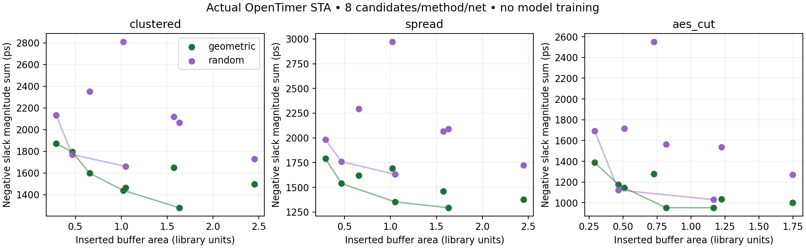
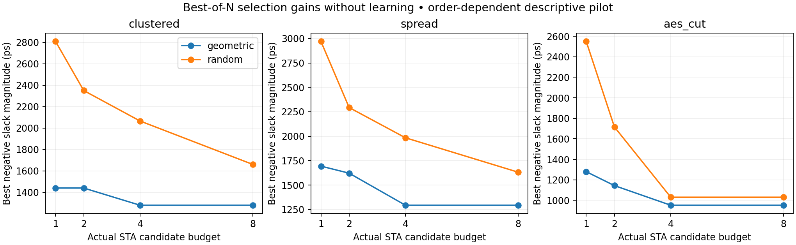

# Matched-budget baseline comparison

**Go: local module behavior. No-Go: inference about BUFFALO model superiority or RL causality.** All values below are locally evaluated, separate from the paper's original numbers. `metrics/summary.json`, `candidates.csv`, `budget_curves.json` and per-candidate `runs/` reports are inspectable.

## Design and budget

Each of three cases has one unbuffered anchor, eight geometric-prior candidates and eight random candidates. The two buffered methods have identical per-index branching factor, inserted-buffer count and cell size: fanout parameter cycles2/3/4 and buffer size advances x2/x4f/x8. The geometric method alternates coordinate sorting axes and places group buffers at integer centroids. The random method shuffles partition membership and independently draws integer coordinates. Thus the comparison tests **partition/location prior as a bundle**, not isolated topology, serialization or model architecture. It is not a van Ginneken implementation or a BUFFALO reimplementation. The random method uses seeded constructive trees, not a trained policy.

Both methods receive eight candidate generations and eight actual OpenTimer calls per case, with no retries/repair/caching in comparison runs. All attempted candidates count; raw invalid unbuffered references are retained separately. Seed202510 plus deterministic per-candidate offsets. Same driver/sinks, allowed non-inverting cells, timing/load, geometry box, RC and evaluator. No model, synthetic-label imitation or API cost. The three-case maximum is the original bounded-pilot limit, not a distributional benchmark.

## Actual results

Best timing among eight candidates; all 48 buffered candidates pass declared structural/fanout/capacitance/Y-output-slew checks, none meets timing. Inserted area is library area (nominal um²). Less-negative slack is better; source/sink cut arcs are included. Power is **not** measured.

| Case | Method | STA calls | Valid | Best TNS(ps) | Its WNS(ps) | Its buffer area |
|---|---|---:|---:|---:|---:|---:|
| clustered synthetic12 | geometric | 8 | 8 | -1279.533 | -111.883 | 1.63296 |
| clustered synthetic12 | random | 8 | 8 | -1660.640 | -149.673 | 1.04976 |
| spread synthetic12 | geometric | 8 | 8 | -1293.173 | -115.761 | 1.63296 |
| spread synthetic12 | random | 8 | 8 | -1631.665 | -145.275 | 1.04976 |
| actual AES fanout10 cut, assumed geometry | geometric | 8 | 8 | -952.391 | -113.078 | 1.16640 |
| actual AES fanout10 cut, assumed geometry | random | 8 | 8 | -1030.836 | -144.987 | 1.16640 |

Unbuffered anchors: clustered TNS−5135.535ps, spread−3687.788ps, AEScut−2219.487ps. All three anchors violate maxfanout4, library maxcap and declared Y-output-slew320ps. These infeasible anchors are diagnostic references, not fair unconstrained solutions to claim performance against.

The geometric prior wins best-of-eight timing here; this is not Pareto dominance. The synthetic-case best-timing selections use more area, so they do not establish dominance of an entire frontier. The AES best-of-eight timing selections use equal area; the synthetic ones do not. Matching at candidate index controls buffer area/count. Geometric clustering and buffer placement change together; their separate contributions remain unidentified. All cases were chosen for engineering validation, not held out; sample sizes do not justify statistical significance/generalization.

## Budget and preference controls without learning

`figures/budget.png` reuses the same eight evaluated candidates to compare first1/2/4/8 best timing. It adds zero STA calls. Improvements from this curve are attributable to selection budget/order, with no policy updates. Candidate order is systematic and can favor some sizes early; do not interpret it as a random-sampling expectation.

For preference behavior, pool the sixteen already evaluated candidates per case and apply separately standardized timing/negative-area weights0/.5/1. This is **sixteen-call fixed-pool selection**, not another eight-call method or an inference-conditioned generator. Candidate generation is held constant. In the actual AEScut, area-only picks geometric2 (area .29160,TNS−1386.949ps), equal weights pick random5 (.46656,−1123.333ps), timing-only picks geometric3 (1.16640,−952.391ps). Changing weights changes selection; it says nothing about a learned conditional distribution. The weighted sum does not guarantee recovery of every nondominated solution.

A separate arithmetic counterexample reproduces the published pseudocode's area-mean sign ambiguity (`metrics/reward_audit.json`). The centered interpretation and literal interpretation are both reported. There is no optimizer or likelihood update in that audit; no GRPO training claim.

## Costs and fidelity

51 comparison evaluations used about2.216s aggregate process wall time on this environment. This includes per-process library parsing and local overhead, and is not comparable to the paper's GPU inference timing or commercial runtime. There is no measured LLM generation time. The evaluator's small cut and approximate RC make it much cheaper than full placement/route/fullchip STA.

Full accounting in `metrics/costs.json`: 54 actual STA processes (51 comparisons + failed ANSI smoke + successful smoke + RC control); one build-pending attempt launched none. Build configure-to-target-completion file timestamps span about186.85s, including orchestration, not CPU time. Free setup used workspace CMake/ninja and inspected source. Data preparation was not independently timed. Local training/modelAPI/fullchip/physical runs are all zero.

The paper separately reports 20M-label SFT over six days on an eight-GPU cluster, ten candidates/prompt, batch16 and ~5s GRPO batch. Teacher generation, device utilization, fullchip refinement and all tuning costs are not fully established. These cannot be charged to local inference or ignored when comparing amortization.

## Still required for mechanism attribution

Hold representation, data/family split, architecture, evaluator and candidate/evaluation budgets constant between genuine SFT-only, net-GRPO and separately added fullchip feedback. Control pretrained versus scratch, teacher quality/quantity and alternative serialization. Include matched-budget heuristic/beam/best-of-N frontiers and total training/data/evaluator cost. The local pilot shows that priors and selection alone can improve these cases; it does not establish what caused the original paper's gains.

The configuration closeout adds no STA calls or candidates. All51 comparison metrics and153 default evaluated input files remain unchanged. Slew legality in this comparison means only declared cell Y output checks; A input slews and full electrical legality remain unverified.

## Bounded feasibility follow-up (2026-10-28)

See [FEASIBILITY_DIAGNOSIS.md](FEASIBILITY_DIAGNOSIS.md). Exactly9 predeclared configurations (three archived baseline replays plus two shallow x8 alternatives per net) were evaluated, separately from the original matched-budget comparison. All9 pass declared structural/cap/fanout and newly measured A/Y-slew checks, with no tool/constraint-contract errors, but all9 still violate80ps timing. Near-source shallow alternatives reduce worst arrival to115–131ps. These measurements improve on the selected baseline, not establish optimality, general Pareto dominance or infeasibility. Earlier Y-only data and the original51-case comparison remain unchanged. SFT/netGRPO/fullchip/power/physical claims remain Not.

## Provenance and local envelope follow-up

[PROVENANCE_AND_ENVELOPE.md](PROVENANCE_AND_ENVELOPE.md) establishes that80ps, input slew, cut output load and RC are local assumptions, not paper/artifact targets. Independent old-log checks find no unit/path mismatch but identify .5fF terminal-load extrapolation below the1.44fF Liberty grid. Twelve predeclared STA calls preserve a before/after replay and evaluate three same-boundary corrected-load actions per net. All actual targets remain80ps. Corrected results expose smaller/slower versus larger/faster choices; Pareto status is per-net/per-load and pairs area/delay from the same implementation. All actual runs still violate80ps. Relaxed target-grid arithmetic is explicitly counterfactual, not paper reproduction. No APIs, model training, paid resources or new physical claims. Old evidence and v3 remain preserved.
