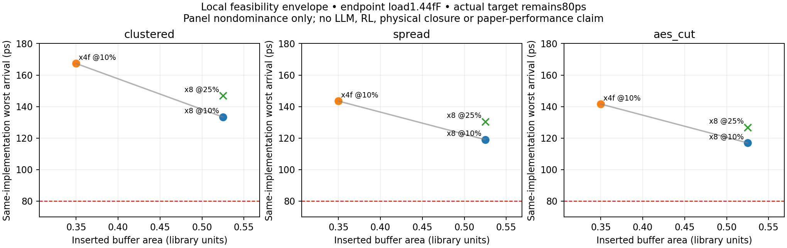

# Constraint provenance and local feasibility envelope

**This is a non-LLM local action/feedback study, separate from BUFFALO performance reproduction.** No paper target was recovered or relaxed. The80ps target remains in every actual new STA run. This study corrects an identified endpoint-load characterization-domain limitation, preserves before/after evidence, and records same-implementation area and delay instead of repeatedly treating one arbitrary threshold as the research result.

## Exact provenance of constraints and values

| Value | Exact origin | Scientific status |
|---|---|---|
| required80ps | Locally authored `src/pilot.py:fixture`, introduced in commit `fcc7584`; mirrored in three local fixture JSONs | Local engineering stress target; **not** paper/artifact-derived |
| clock100ps / output delay20ps | Same local fixture/emitter; `required=period−output_delay` | Cut-boundary timing convention; virtual clock is not CTS |
| Paper delay target range100ps–1ns | Coauthor preprint p3 Table II, dataset sampling description | Different reported range; does not identify an80ps test or equate the paper's timing boundary to this whole-path cut |
| Synthetic source/sink BUFx2 | Local fixture choice in `pilot.py` | No original teacher label or learned tree |
| AES source BUFx2 / ten BUFx2 sink A pins | Public OpenSTA mapped AES `_08638_`, driver `_16685_:Y`; exact ten loads retained by `src/extract_net.py`, source URL/hash in `config/aes_cut.json` | Real cut connectivity and cell identity, **not** original placement, downstream loading or full-chip required times |
| Library cap/area/timing | BSD3 ASAP7 INVBUF RVT TT NLDM from pinned OpenSTA commit `384b539085c54eef46cbaa02e2e17d2b983247e5`; exact compressed file and license header in `vendor/` | Actual library tables; nominal0.7V,25C, TT; no silicon/physical calibration claim |
| BUFx2 A pin cap | Library scalar/rise .534279fF, fall .534230fF | Scalar is conservative max for declared cap checks; actual engine uses transition-specific cap |
| x4f/x8 A pin caps | Library scalar/rise1.00419/.852045fF, fall1.00375/.850973fF | Cell-size labels do not justify guessing capacitance or delay; actual table values used |
| input delay0 / slew10ps | Local boundary assumption; current emitter reads configuration | Not extracted from original design context or the paper |
| endpoint load .5fF | Local output-load assumption applied at each cut load cell Y | Below the BUF x2 delay-table minimum1.44fF; old results include linear extrapolation |
| corrected endpoint load1.44fF | Exact minimum characterized output-cap axis of BUF x2 NLDM | Explicit domain repair for the new local study; not a faithful reconstruction of original design loading |
| box100×100 assigned um, placements, RC .5ohm/um and .15fF/um | Local fixture choices | Assumed pi branches, no real routing/layer extraction or LEF/site/scale validation |
| maxfanout4 | Local validation choice | Not the paper's example maxfanout16 |
| maxslew320ps | Library default/output-pin max_transition320, applied locally as declared A/Y limit in follow-ups | Does not establish all constraints or full electrical legality |

The local measured path is primary input a→driver A/Y→buffer cells→sink A/Y→output y, with source and load-cell delays included. The exact boundary of the paper's delay target is not fully reconstructed. Thus comparing80ps here to the paper's target range numerically does not make these equivalent tasks. Existing generated SDC and all local-required-time scoring are mutually consistent; the mismatch was provenance/characterization scope, not an80-versus100 arithmetic bug.

## Independent unit and path sanity checks — no new STA

`src/audit_units.py` reads old diagnostic observations, actual Liberty tables and declared geometry; it independently performs Python bilinear interpolation/extrapolation. It recomputes92 rise/fall cell arcs across three prior implementations with maximum residual .000524ps. Transition-specific rise/fall pin caps are used, not the scalar maximum for both. An initial strict trial using scalar caps produced a .0054ps fall-arc mismatch; correcting the independent check to the library's fall cap resolved it without changing the engine or old evidence.

Library header and engine log agree: time1ps=1e−12s, capacitance1fF=1e−15F, library resistance1kΩ. SPEF explicitly declares1Ω; inspected `OpenTimer/ot/timer/unit.cpp:_rebase_unit` scales SPEF resistance by the SPEF/library ratio .001 before propagation. The log says rebase to1Ω but this wording alone does not describe the internal representation. There is no observed1000× unit error.

Concrete existing clustered shallow-x8 example: total driver rise load is wire4.5fF + three x8 input caps3×.852045fF =7.056135fF. At10ps input slew, the x2 rise table interpolates to30.9704ps, matching observed D:Y−D:A30.9704ps. For its B2 branch,6Ω×(.9fF wire half-cap+.852045fF pin)×.001 =.010512ps, matching raw A−upstreamY propagation .0105ps within report precision. Critical-path sums also match endpoint arrival. The extra unlabeled numeric column in OpenTimer's formatted path is `ipower` (`ot/timer/path.cpp`), not another delay/load; it was not used for timing or claimed as measured design power.

The audit identified68 extrapolated leaf arcs among92: all local .5fF terminal loads are below the1.44fF load-grid minimum. That is a real limitation of the original fixture assumptions, even though Liberty extrapolation is accepted by the tool and is not a failed STA call. The new common-load pool repairs this domain issue explicitly. Original80ps violations and old measurements remain historical, not erased or silently reinterpreted.

## Predeclared bounded repair and panel

`config/envelope_plan.json` was written before evaluation and its SHA256 is recorded in `metrics/envelope.json`. Exactly4 configurations per net, **12 new STA calls maximum**:

1. Replay shallow x8 at10% centroid distance, original .5fF load: same-implementation before measurement.
2. Same x8/topology/position with1.44fF output load: paired domain repair.
3. Same shallow topology/10% position with allowed x4f and1.44fF load: size/area control.
4. Same x8/topology/1.44fF load with25% position: placement control.

Choices use the existing allowlisted actions and declared shallow geometric construction. No hidden teacher labels, model, oracle or adaptive search. Source/sink cells,80ps target, input transition, nominal corner, wire RC and other constraints remain fixed. This is a tiny action/feedback panel, not a broad sweep or paper-training substitute. Every attempted call was budgeted; all12 succeeded, with zero call/preparation, tool, observation or contract errors. Newly measured A/Y slew and declared constraints pass. Physical legality remains unverified.

## Same-implementation results and Pareto outcomes

The paired correction increases worst arrival only2.304ps on clustered and2.267ps on spread/AES. Therefore the prior extrapolation needs disclosure/repair but does not explain the much larger80ps failure gap.

| Case | x8@10%, old .5fF delay | x8@10%, corrected1.44fF delay | Increase |
|---|---:|---:|---:|
| clustered | 131.101ps | 133.405ps | 2.304ps |
| spread | 116.754ps | 119.021ps | 2.267ps |
| AEScut | 114.709ps | 116.976ps | 2.267ps |

The **primary Pareto pool is only the three1.44fF implementations for each net**; old-load replays are kept out of that frontier. Area and delay come from each same evaluated tree, not from separate best-area and best-delay trees.

| Case | Fixed action | Buffer area | Worst arrival ps | Panel outcome |
|---|---|---:|---:|---|
| clustered | x4f@10% | .34992 | 167.333 | nondominated: smaller/slower |
| clustered | x8@10% | .52488 | 133.405 | nondominated: larger/faster |
| clustered | x8@25% | .52488 | 146.973 | dominated within this panel |
| spread | x4f@10% | .34992 | 143.484 | nondominated: smaller/slower |
| spread | x8@10% | .52488 | 119.021 | nondominated: larger/faster |
| spread | x8@25% | .52488 | 130.482 | dominated within this panel |
| AEScut | x4f@10% | .34992 | 141.597 | nondominated: smaller/slower |
| AEScut | x8@10% | .52488 | 116.976 | nondominated: larger/faster |
| AEScut | x8@25% | .52488 | 126.768 | dominated within this panel |

This panel demonstrates an actual area-delay tradeoff and a worse placement action at fixed area. It is not a global Pareto frontier, optimality proof, generalized result or GRPO effect. All12 actual runs retain80ps and all violate it.

For target-free interpretation, the measured worst arrival is the minimum required arrival that would make **that fixed implementation's max endpoint timing** nonnegative. `counterfactual_endpoint_feasible` records the predeclared80/100/120/160/200ps grid by arithmetic only, without rerunning or changing SDC. At a counterfactual120ps boundary, corrected x8@10% would pass spread/AES but not clustered. At160ps, all three corrected x8@10% would pass. These are transparently relaxed local-budget counterfactuals, not faithful paper results, actual new closure runs or whole-chip/hold closure claims.

## Verification, cost and preservation

`src/verify_envelope.py` independently rechecks12 raw STA outputs, three old-implementation replay matches, per-tree areas, actual80ps required times, output slack consistency and within-load Pareto status. It also independently recomputes368 cell arcs; maximum residual .000887ps. Every cell arc in all nine corrected-load implementations lies within the actual characterized load and slew grid. Verification adds zero STA.

New evaluation cost:12 successful local STA calls, about .583s aggregate process wall time; zero failed calls, API calls, SFT/GRPO steps, paid resources or physical runs. Cumulative actual engine invocations now75; original51 comparisons and later9 diagnostics remain separate budgets. New arcs/replays are not appended to old data as if measured then. The v3 ZIP and git/Library history are preserved, with v3 SHA256 `2d4a3782331822e7c95e0bc5061df761b1855c89c20cc513cbf714e0d3f345ab`.

No execution blocker remains for this study. Unresolved scientific scope: assumed geometry/RC and cut boundaries, no original model/teacher/code artifacts, no SFT/netGRPO/chip feedback, no physical/legalizer/power validation or independent second-engine calibration. Credential/API restrictions were respected; no pasted key was accessed, transmitted or persisted.

## Final accounting and registration limit

Cumulative75 actual STA processes =51 original comparisons +3 setup/validation calls (one failed ANSI-netlist smoke, one corrected successful smoke, one RC control) +9 feasibility diagnostics +12 envelope calls. The earlier build-pending attempt launched no engine and is not included. No further experiments were run during the publication handoff.

Plan hashes independently verify the exact archived plan contents; they do **not** provide independent chronological preregistration or an immutable external timestamp. The task's execution sequence records that the local plan files were written before their evaluation commands. Treat this as locally declared-before-execution evidence, not externally certified preregistration.
